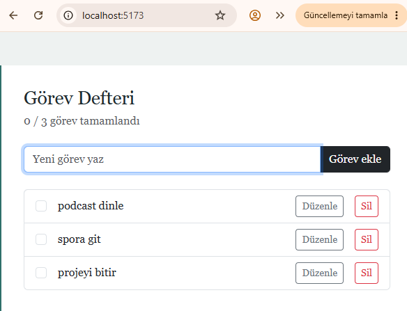

# Görev Defteri

React + TypeScript + Vite ve Bootstrap 5 ile yazılmış görev uygulaması. Veriler LocalStorage'da saklanır.

## Özellikler
- Ekle: yeni görev oluşturma
- Listele: görevleri listeleme
- Güncelle: başlık düzenleme ve tamamlandı işaretleme
- Sil: görev silme

## Klasör yapısı
- `src/components`: TaskForm, TaskList, TaskItem
- `src/pages`: Home
- `src/interfaces`: Task tipi
- `src/hooks`: useLocalStorage

## Çalıştırma
```
npm install
npm run dev
```

## Ekran görüntüsü


## Yayın
Netlify: build komutu `npm run build`, publish klasörü `dist`. Canlı bağlantı: (buraya ekle)
